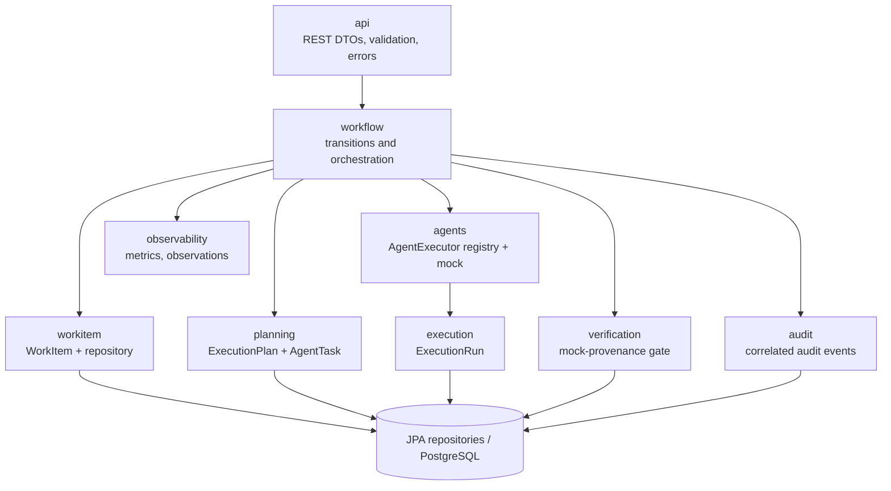

# Component diagram

The Spring application is a modular monolith; packages group behavior by capability. Controllers own HTTP mapping and validation, while workflow decisions remain in application services.

The provider-neutral `AgentExecutor` is the only supported extension seam for execution. There is currently one registered implementation, `mock`. Architecture tests prevent API types from depending directly on persistence repositories.
