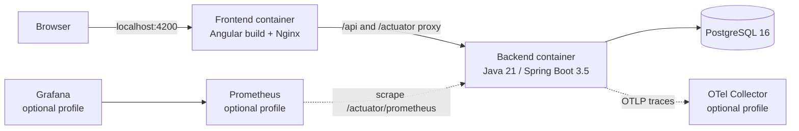

# Container diagram

`docker compose up --build` starts the three required containers. Monitoring services exist only under the `observability` profile. Services and published ports bind to loopback in the supplied Compose configuration.
