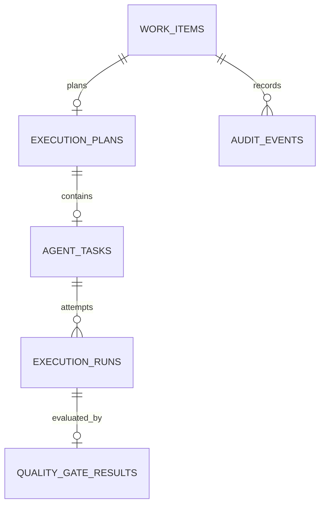

# Data model

Flyway migration `V1__workflow.sql` defines the persisted workflow:

- **Work item** contains title, description, acceptance criteria, priority, workflow status, timestamps, and an optimistic-lock version.
- **Execution plan** is one-per-work-item in this MVP. Approval actor and timestamp are stored with its status and version.
- **Agent task** contains the bounded task text and attempt count. One task is created for each plan.
- **Execution run** records provider type, simulated flag, outcome, output summary or error code, correlation ID, and start/completion times.
- **Quality-gate result** records a gate status and concise evidence for each execution.
- **Audit event** stores actor, action, resource identity, work-item identity, occurrence time, and correlation ID. It intentionally excludes task and executor payloads.

UUIDs are stable primary keys. Foreign keys, unique constraints, state version columns, and the audit/run indexes are managed by Flyway. Hibernate is configured to validate rather than generate schema.
