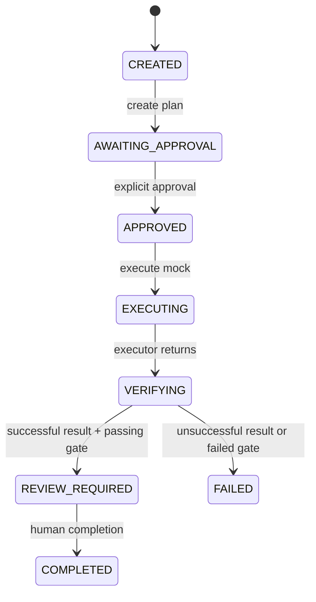

# Execution lifecycle

Every transition is checked against persisted state. Duplicate plan creation, approval outside the approval state, or execution before approval returns a conflict. Work-item and plan writes use optimistic locking to reject concurrent stale changes.

The synchronous run persists its start, simulated result, independent gate evidence, final state, and correlated audit events. A mock `FAILURE` or `TIMEOUT` scenario cannot become a passing completion. A passed gate only checks mock provenance; the user must explicitly mark the work item complete. Retry, cancellation, durable asynchronous dispatch, and recovery after process termination are not implemented.

Micrometer observations include the HTTP server spans and explicit workflow, executor, and quality-evaluation operations. Correlation and work-item IDs are attached as high-cardinality span attributes and are not metric labels. Persistence participates in the enclosing request/operation span; this MVP does not claim per-SQL span coverage.
