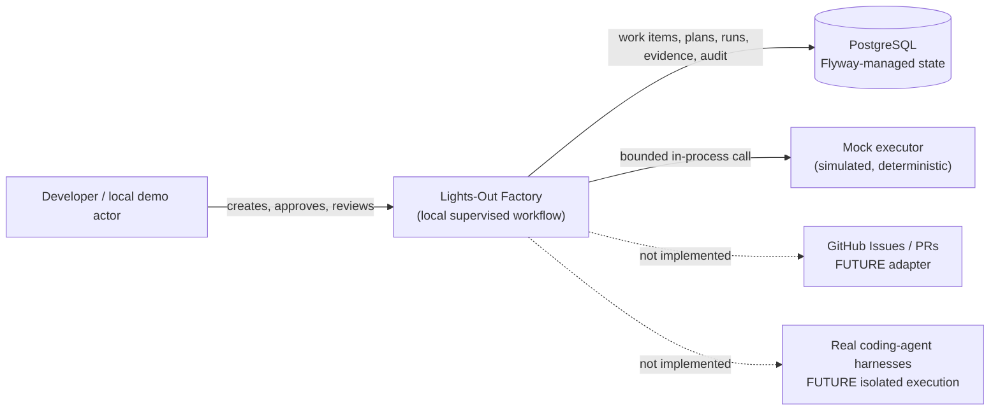
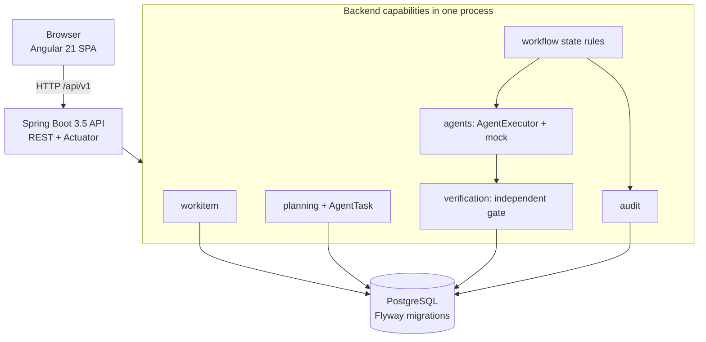

# Implemented architecture

This repository currently runs as one Spring Boot modular monolith, one Angular SPA, and PostgreSQL. All browser API calls go through the local UI origin in Compose; the Angular dev server uses a local proxy.

## C4 context



## C4 containers and capabilities



## Executable workflow

```mermaid
sequenceDiagram
  actor Human
  participant UI as Angular UI
  participant API as Spring API
  participant DB as PostgreSQL
  participant Mock as MockAgentExecutor
  participant Gate as QualityGateEvaluator
  Human->>UI: Create work item
  UI->>API: POST /work-items
  API->>DB: Persist work item + audit event
  Human->>UI: Create plan
  UI->>API: POST /work-items/{id}/plans
  API->>DB: Persist plan/task; status AWAITING_APPROVAL
  Human->>UI: Approve plan
  UI->>API: POST /plans/{id}/approve
  API->>DB: Persist actor, decision, timestamp, audit
  Human->>UI: Execute mock
  UI->>API: POST /plans/{id}/execute
  API->>DB: Record run start + correlation
  API->>Mock: Execute fixed task input (no network/host command)
  Mock-->>API: Deterministic simulated outcome
  API->>Gate: Independently evaluate provenance/status
  Gate-->>API: Persist gate status and evidence
  API->>DB: Persist final state + audit trail
  API-->>UI: SIMULATED run and gate result
  UI-->>Human: Show evidence and review action
```

## Responsibilities and guarantees

- **Workflow orchestration** checks current persisted state and rejects illegal/repeated approvals or executions. Optimistic `@Version` fields protect work-item and plan writes.
- **Agent selection** is the `AgentExecutorRegistry`; the registry only contains `mock`.
- **Agent execution** is `MockAgentExecutor`, an in-process deterministic implementation. It is not an AI model, shell, sandbox, or external provider.
- **Verification** runs independently of executor success and persists a gate result. The current gate validates mock provenance only.
- **Governance** is the local approval decision and explicit human completion after a passing gate. Production approval, auth, and policy are not implemented.
- Request correlation is returned in `X-Correlation-ID`, included in the run and its audit events, and placed in the logging MDC.
- A request transaction persists the tiny mock run synchronously. No durable distributed queue, retry guarantee, cancellation, or exactly-once claim is made.

## Local ports

- `localhost:4200`: SPA and reverse proxy in Compose.
- `localhost:8080`: API and Actuator, available locally for development.
- `localhost:5432`: PostgreSQL, bound to loopback.

There is no remote GitHub import, runtime multi-agent execution, external coding-agent provider, or deployment integration.
