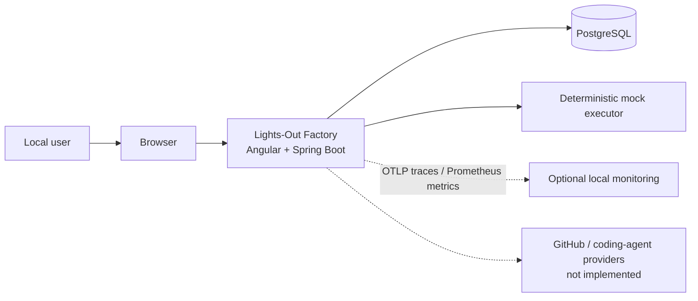

# System context

Lights-Out Factory is a local supervised-workflow demonstration. A local user creates requirements, approves a deterministic plan, starts an in-process simulated executor, and reviews persisted evidence. The application does not connect to GitHub, invoke an AI service, or modify another repository.

The user explicitly approves a persisted plan before execution. A passing simulated provenance gate only permits a later human completion action; it does not verify external source code. See [security](security.md) and [execution lifecycle](execution-lifecycle.md).
